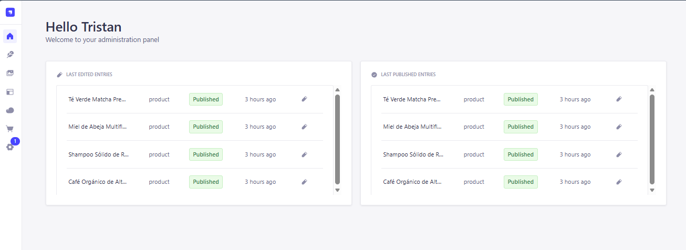
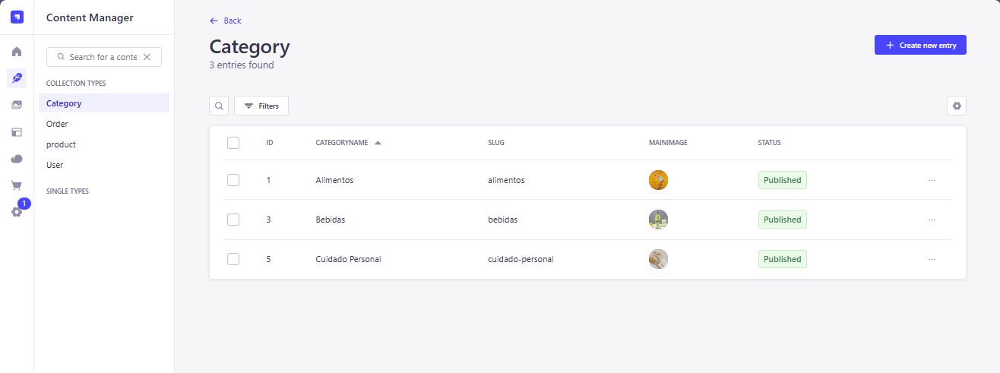

# 🌿 Nature-One Backend - CMS Headless (Proyecto Demostrativo)

Este repositorio contiene la aplicación de backend de **Nature-One**, una plataforma web de comercio electrónico de productos naturales. Desarrollado con **Strapi v5**, este backend actúa como un CMS Headless (Content Management System) proporcionando un panel de administración interactivo para gestionar el inventario de productos, las categorías, las cuentas de usuario y procesar los pagos mediante la integración con la API de Stripe.



---

## 🚀 Tecnologías Utilizadas

El backend está construido con herramientas robustas de desarrollo de servidores y bases de datos:

- **[Strapi v5](https://strapi.io/)**: CMS Headless basado en Node.js que proporciona una API REST lista para usar y un panel administrativo completo.
- **[SQLite (better-sqlite3)](https://github.com/WiseLibs/better-sqlite3)**: Base de datos ligera en archivo utilizada de forma predeterminada para el entorno de desarrollo local.
- **[Stripe SDK](https://github.com/stripe/stripe-node)**: Integración para la creación de sesiones de pago seguras y gestión de transacciones.
- **[Cloudinary Provider](https://cloudinary.com/)**: Proveedor de almacenamiento en la nube configurado para gestionar la subida y almacenamiento de imágenes de productos de manera eficiente.
- **[pnpm](https://pnpm.io/)**: Gestor de paquetes rápido elegido para el manejo de dependencias de la aplicación.

---

## 📁 Estructura del Proyecto

El backend de Strapi está estructurado de la siguiente forma:

```text
/
├── config/                # Configuraciones globales (servidor, base de datos, plugins, middlewares)
│   ├── database.js        # Configuración dinámica de SQLite (dev) y PostgreSQL (prod)
│   ├── plugins.js         # Habilitación de subida de imágenes a Cloudinary
│   └── server.js          # Configuración del host, puerto y claves de la app
├── database/              # Esquemas y configuraciones de migración de bases de datos
├── public/                # Archivos públicos de servidor (iconos, favicon)
├── src/
│   ├── api/               # Controladores, rutas y servicios de la API de contenido
│   │   └── order/         # Lógica personalizada para cobros con Stripe
│   └── index.js           # Inicialización y hooks del ciclo de vida de Strapi
├── .env.example           # Plantilla de variables de entorno del sistema
├── .gitignore             # Configuración de exclusiones de archivos (excluye bases de datos *.db y variables .env)
├── package.json           # Dependencias del servidor y scripts de desarrollo
└── tsconfig.json          # Soporte y configuración de TypeScript
```

---

## ⚙️ Configuración del Entorno (.env)

El backend requiere configurar ciertas variables de entorno para el funcionamiento de Stripe, la seguridad y el servidor de Strapi.

1. Copia el archivo de plantilla `.env.example` para crear tu configuración local:
   ```bash
   cp .env.example .env
   ```
2. Abre el archivo `.env` recién creado y completa las claves necesarias (como `STRIPE_KEY` de tu panel de desarrollo en Stripe y las claves de seguridad de Strapi).

> [!IMPORTANT]
> Nunca comitas el archivo `.env` al repositorio de Git. Este archivo ya se encuentra listado en `.gitignore` para tu protección.

### ⚠️ Nota de Seguridad sobre la Base de Datos SQLite (`data.db`)

Para evitar subir la base de datos de desarrollo a GitHub, `data.db` está configurado en el archivo `.gitignore`. Si Git ya rastreaba este archivo debido a un commit previo en tu repositorio, puedes desvincularlo (sin borrar tu base de datos local) ejecutando:
```bash
git rm --cached data.db
```

---

## 🛠️ Comandos de Desarrollo

En este proyecto utilizamos **`pnpm`** como gestor de paquetes exclusivo. Asegúrate de tenerlo instalado de forma global.

### 1. Instalar dependencias
Instala todos los paquetes requeridos por Strapi y sus plugins:
```bash
pnpm install
```

### 2. Iniciar servidor en modo desarrollo
Inicia el servidor local de Strapi con recarga en tiempo real y reconstrucción de la interfaz administrativa automática:
```bash
pnpm dev
# o bien
pnpm develop
```
El panel de administración estará disponible en: `http://localhost:1337/admin`

### 3. Compilar el panel de administración
Compila los archivos estáticos necesarios para la interfaz del panel administrativo:
```bash
pnpm build
```

### 4. Iniciar servidor en modo producción
Inicia el servidor de Strapi listo para recibir solicitudes, con el recargado automático desactivado:
```bash
pnpm start
```

---

## 🔒 Características de Seguridad
- **Ocultamiento de Credenciales**: Las claves de autenticación de Strapi, el token JWT y la llave privada de Stripe se manejan estrictamente a través de variables de entorno mediante un archivo `.env` local.
- **Protección de Datos Locales**: Las bases de datos SQLite (`*.db`) se encuentran configuradas en el archivo `.gitignore` para prevenir fugas accidentales de registros de clientes, administradores o transacciones de prueba.

---

## 📸 Capturas de Pantalla (Panel de Administración)

A continuación se muestran los módulos de Strapi configurados en este proyecto:

### 📦 Administrador de Contenidos (Categorías y Productos)


### 🔐 Roles, Permisos y Claves API

